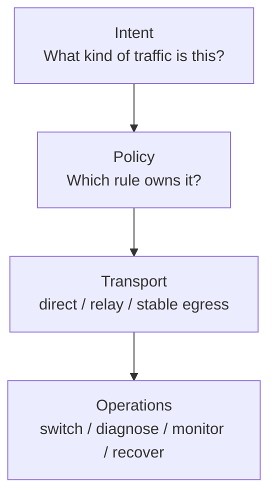
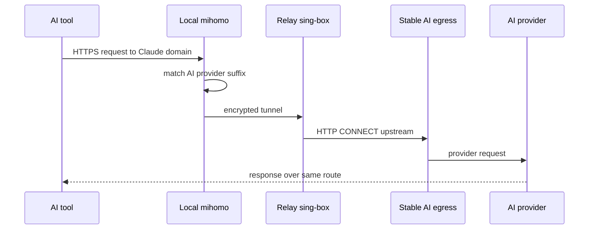
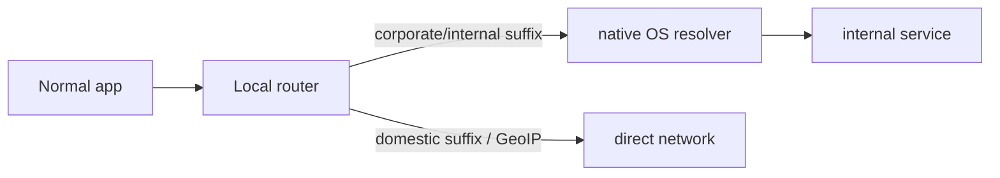
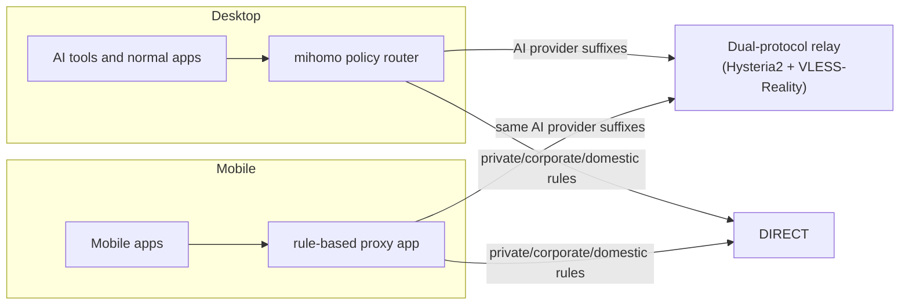

# Architecture

AgentRouteKit separates classification, transport, and operations.

## Layers

## Runtime

Corporate/internal and domestic traffic should not touch the stable AI egress.

## Client Surfaces

Desktop and mobile clients use the same policy order. The desktop path is automated by this repository's macOS scripts. The mobile path is profile/rule reuse through a compatible client.

Mobile clients should import an equivalent Mihomo/Clash-style profile and keep the same rule order:

1. Loopback, private IP ranges, and redacted corporate/internal suffixes go `DIRECT`.
2. AI provider suffixes go to the stable AI route.
3. Domestic/direct suffixes and CN GeoIP go `DIRECT`.
4. General overseas or unmatched traffic follows the selected proxy group.

See [mobile-clients.md](mobile-clients.md) and [../policy/routing-demo.yaml](../policy/routing-demo.yaml) for a copyable starting point.

## Transport High Availability: Dual-Protocol Fallback

Cross-border network degradation often targets specific protocol characteristics during peak hours. AgentRouteKit solves this at the transport layer:

1. **Primary Protocol (Hysteria 2 with Port Hopping)**:
   - High-throughput UDP/QUIC protocol with single-sided congestion control.
   - Mitigates ISP 4-tuple QoS throttling by hopping client destination ports across a configured range (e.g. `20000-40000`).
   - The relay host maps this range back to the listener port via Linux kernel NAT (`iptables -t nat -A PREROUTING -p udp --dport 20000:40000 -j REDIRECT --to-ports 443`).
2. **Fallback Protocol (TCP VLESS-Reality)**:
   - Zero-dependency TLS 1.3 protocol borrowing real handshake certificates from public CDN domains (e.g. `gateway.icloud.com`).
   - Standard TCP congestion control is retained, providing a reliable escape hatch if cross-border UDP packets are heavily dropped or blackholed.
3. **Automatic Failover**:
   - The local router groups both nodes into a `fallback` proxy-group (`ai-relay-group`) with periodic health checks (`/generate_204`).
   - Normal traffic prefers Hysteria 2. When UDP degradation causes probe timeout, traffic automatically and transparently fails over to VLESS-Reality.

## DNS Decoupling: Preventing Single-Point Failure Cascades

In typical Fake-IP setups, when a direct connection is initiated, the router still needs to resolve the real IP to determine routing (e.g., matching GeoIP rules). If a direct domain (such as Apple Anycast CDN or a domestic portal) resolves to a foreign IP, standard routers invoke fallback remote DNS servers over the proxy tunnel.

If the overseas proxy fluctuates or dies, overseas DNS timeouts freeze the local resolver pipeline, causing domestic apps and operating system services to appear disconnected.

AgentRouteKit decouples DNS via `nameserver-policy`:
- Corporate domains resolve via native/system DNS (`system`).
- Domestic rule-sets (`rule-set:cn`) and user-specified `DIRECT_DOMAINS` are explicitly bound to trusted domestic resolvers (`223.5.5.5`, `119.29.29.29`).
- Remote fallback DNS (`https://1.1.1.1/dns-query`, `https://8.8.8.8/dns-query`) is only queried for unclassified overseas domains and routes through the healthy relay node.
- If the overseas relay goes completely offline, domestic browsing, office apps, and system services remain 100% operational.

## Anti-Loop Protection (TUN Bypass)

When running in TUN mode or system proxy mode, administrative traffic (e.g. SSH to the relay host or connections to the stable egress endpoint) must never be intercepted by the virtual adapter and re-encapsulated into the proxy tunnel.

`render-config.py` automatically injects highest-priority direct bypass rules (`IP-CIDR,<RELAY_IP>/32,DIRECT,no-resolve`) at the top of the ruleset to prevent recursive routing loops.

## Why a Relay Exists

The relay keeps the client-to-relay path encrypted and gives the project one central place to:

- Forward Claude domains to stable egress.
- Let general overseas traffic use relay direct egress.
- Rotate stable egress providers without changing client policy.
- Add server-side health checks and fallback later.
